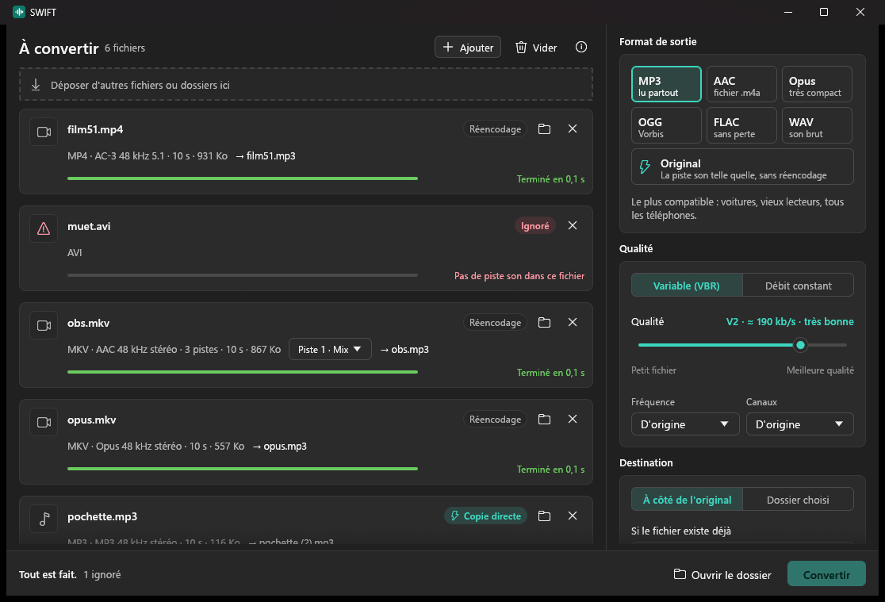
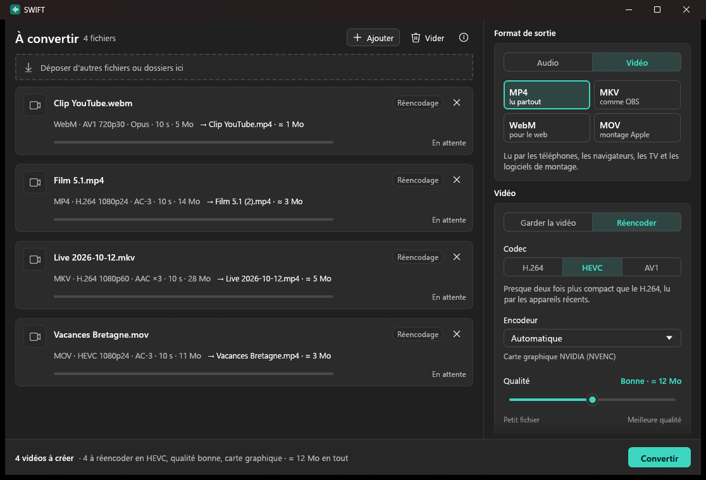

# SWIFT

**Smart Wave Interchange & File Transcoder**

SWIFT convertit vos vidéos et vos sons : sortir le son d'une vidéo, passer un MKV d'OBS en MP4,
réduire une vidéo, changer un son de format. On glisse les fichiers dans la fenêtre, on choisit
le format, on clique sur Convertir. Gratuit, sans compte, sans publicité, rien à installer.

## Ce qu'il fait

### Le son

- Vidéos (MOV, MP4, MKV, WebM, AVI, TS, FLV, WMV…) et sons (MP3, M4A, WAV, FLAC, OGG, Opus,
  WMA, AC-3…) vers MP3, AAC (M4A), Opus, OGG Vorbis, FLAC ou WAV.
- Le format « Original » sort la piste son telle quelle, sans aucune perte, en une fraction de
  seconde.
- Si le son est déjà au bon format (l'AAC d'une vidéo de téléphone vers M4A, l'Opus d'une vidéo
  YouTube), il est recopié sans être réencodé : c'est la « Copie directe ».
- Enregistrements OBS à plusieurs pistes : la piste principale, une piste précise, ou un fichier
  par piste.
- Tags, chapitres et pochette gardés quand le format le permet. La position GPS des vidéos de
  téléphone n'est pas recopiée.

### La vidéo

- Vers MP4, MKV, WebM ou MOV.
- « Garder la vidéo » change seulement de conteneur, sans réencoder : un MKV d'OBS devient un MP4
  en quelques secondes, avec toutes ses pistes son et leurs noms.
- Réencodage en H.264, HEVC, AV1 ou VP9 par la carte graphique (NVIDIA, AMD ou Intel) ou par le
  processeur : qualité au curseur, résolution, images par seconde, et la taille estimée de
  chaque fichier avant de lancer.
- Le HDR des vidéos de téléphone est gardé en HEVC et en AV1.

### Partout

- Plusieurs fichiers en même temps, sur tous les cœurs du processeur, en priorité basse pour ne
  pas gêner un jeu ou un stream.
- Jamais d'écrasement sans demander.
- « Convertir avec SWIFT » au clic droit de l'Explorateur, si vous le voulez.
- Mises à jour vérifiées, directement depuis l'appli : pas besoin de revenir sur GitHub.
- Thème clair ou sombre, comme Windows.

## Vitesse

Mesuré sur un Ryzen 9 5900X avec une RTX 4070 SUPER, en comparant avec `ffmpeg` en ligne de
commande compilé à partir des mêmes sources, avec les mêmes réglages :

| Conversion | ffmpeg | SWIFT |
|---|---|---|
| Son d'une vidéo MOV d'une heure vers M4A (copie directe) | 1,55 s | 1,33 s |
| Vidéo de 10 min vers MP3 V2 | 4,70 s | 4,66 s |
| Vidéo de 10 min vers FLAC | 0,98 s | 0,80 s |
| 48 MP3 de 4 min vers Opus | 79,7 s (un par un) | 8,0 s |
| MKV d'OBS de 20 min (3,4 Go, 3 pistes) vers MP4, sans réencoder | 2,65 s | 2,97 s |
| Même MKV en 1080p60 vers HEVC par la carte graphique | 159,5 s | 160,5 s |
| Même MKV vers HEVC en 720p30 | 54,9 s | 55,8 s |
| 2 min en 1080p60 vers AV1 par le processeur | 33,9 s | 34,8 s |

Le programme pèse 38 Mo une fois dézippé (15 Mo en zip) et s'ouvre en 0,3 s.

## Télécharger

Dans les [Releases](../../releases) : télécharger `SWIFT-x.y.z-portable.zip`, le dézipper où
vous voulez, lancer `SWIFT.exe`. Windows 10 ou 11, 64 bits. Le zip `SWIFT-Licences-x.y.z.zip`
contient seulement le LISEZMOI et les licences, qui sont aussi dans le zip portable.

Pour tout retirer : couper « Clic droit dans l'Explorateur » dans les options, puis supprimer le
dossier de SWIFT et le dossier `%APPDATA%\SWIFT`. Le fichier LISEZMOI explique le détail.

## Windows va peut-être se méfier

Au premier lancement, Windows peut afficher « Windows a protégé votre ordinateur », et certains
antivirus peuvent se méfier de SWIFT. Ce n'est pas parce que SWIFT est dangereux : c'est parce
qu'il n'est pas signé numériquement. Un certificat de signature coûte plus de 100 € par an, et
SWIFT est gratuit, alors je ne l'ai pas pris. Pour Windows, un programme non signé et encore peu
téléchargé est suspect par défaut.

Pour le lancer quand même : cliquer sur « Informations complémentaires », puis sur « Exécuter
quand même ». Cela n'arrive qu'une fois.

Vous pouvez vérifier vous-même ce que vous téléchargez : la page de chaque version donne
l'empreinte SHA-256 de son zip. Dans PowerShell, `Get-FileHash .\SWIFT-x.y.z-portable.zip` doit
donner la même.

Les mises à jour sont signées : SWIFT n'installe que ce que j'ai signé avec ma clé, et vérifie
l'empreinte de chaque fichier avant de l'utiliser.

## Licence

SWIFT est gratuit : on peut l'utiliser et le donner librement, mais pas le vendre. Son code n'est
pas publié. Le texte complet est dans [LICENCE.txt](LICENCE.txt).

## Composants

SWIFT convertit avec [FFmpeg](https://ffmpeg.org) 9.0.2 (LGPL 2.1), avec
[LAME](https://lame.sourceforge.io) 4.0 pour le MP3 (LGPL), Opus, Ogg et Vorbis de
[Xiph](https://xiph.org) (BSD), et pour la vidéo SVT-AV1, libvpx et dav1d (BSD) et les
encodeurs des cartes graphiques NVIDIA, AMD et Intel. Aucune de ces bibliothèques n'est sous
GPL. Elles sont dans des DLL séparées, que l'on peut remplacer. Leurs sources exactes sont
fournies sur simple demande à [Oka@Akiden.fr](mailto:Oka@Akiden.fr), pendant au moins trois ans.
Le détail est dans [COMPOSANTS.md](COMPOSANTS.md).

Fait par Oka.
